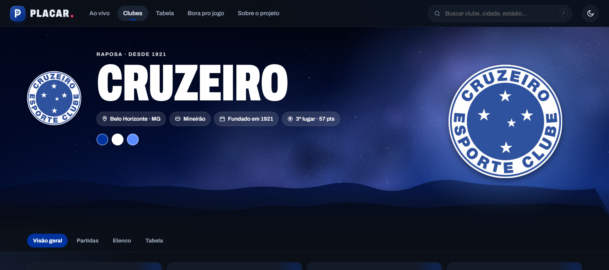

# PLACAR. — futebol brasileiro em tempo real

### ▶ [Acessar o site](https://alansouzadev7.github.io/Projeto_PeladinhaFC/)

> Versão publicada no GitHub Pages, com os dados gravados no projeto. Para os dados ao vivo (placares, notícias e minuto a minuto), rode a API localmente — veja [Como rodar](#como-rodar).

Projeto de portfólio: uma plataforma de resultados do **Brasileirão Série A 2026** com página temática para cada um dos 20 clubes, dados reais, campinho interativo para montar o time, prancheta tática e narração minuto a minuto.

Feito com **HTML, CSS e JavaScript puro** (sem frameworks) e uma **API em Python** (só biblioteca padrão).



## Como rodar

```bash
python -X utf8 server/placar_api.py
```

Abra <http://localhost:8000>. A API serve o site e mantém os dados atualizados em segundo plano.
Sem a API (por exemplo, `python -m http.server`), o site funciona com os dados gravados em `js/`.

### Sem depender de um computador ligado

O site publicado no GitHub Pages se mantém atualizado sozinho:

| O quê | Como |
|---|---|
| Placar ao vivo, intervalo, próximas rodadas, temporada dos clubes, minuto a minuto | o navegador consulta a ESPN direto (a cada 20 s durante os jogos) |
| Tabela, cartões, notícias, pendurados, lesões, minutagem, histórico | o **GitHub Actions** ([`.github/workflows/dados.yml`](.github/workflows/dados.yml)) roda `server/placar_api.py --snapshot` a cada 30 min e grava `js/live-data.js`, `js/player-stats.js` e `js/club-form.js` |

Para atualizar na hora: aba **Actions** do repositório › **Atualizar dados** › **Run workflow**.

## O que tem

| Área | Descrição |
|---|---|
| **Ao vivo** | Rodada agrupada por dia, navegação entre rodadas, favoritos, próximo jogo e artilharia. **Placar em tempo real** mesmo sem a API (no GitHub Pages também): com jogo perto do horário ou rolando, o navegador consulta o placar da ESPN a cada 20 s. As **próximas rodadas** entram sozinhas pelo calendário da ESPN (agrupadas por data, já que a ESPN não informa o número da rodada; jogos adiados aparecem marcados), e o site passa para a rodada seguinte quando a atual termina. |
| **Clubes** | 20 páginas no tema de cada clube, com uma **aparição animada do escudo** inspirada no que ele significa. O Cruzeiro tem a versão em tela cheia (canvas): a câmera viaja pela Via Láctea até o Cruzeiro do Sul e as cinco estrelas formam o escudo. |
| **Partidas do clube** | A temporada inteira de cada clube, mês a mês: todos os jogos e placares já disputados (com pênaltis) e os jogos por vir com o horário de Brasília; quando a CBF/Conmebol ainda não marcou o horário, aparece **"A definir"**. Filtro por competição (Brasileirão, Copa do Brasil, Libertadores, Sul-Americana, Recopa, Supercopa e estaduais cobertos pela ESPN: Carioca, Paulistão, Mineiro e Gauchão) e resumo de vitórias, empates, derrotas e gols. |
| **Retrospecto** | Na visão geral de cada clube: **últimos 5 jogos** (V/E/D, placar, pênaltis, casa ou fora) e **próximos 5**, em todas as competições (Brasileirão, Copa do Brasil, Libertadores e Sul-Americana). Sem a API, a página busca a agenda atualizada direto da ESPN. |
| **Estatísticas do elenco** | Na visão geral de cada clube e na aba "Estatísticas": **pendurados** (2 amarelos, o próximo suspende), **jogos seguidos**, **departamento médico** e **reservas mais usados** por minutagem. Cartões e minutos vêm das súmulas de todos os jogos do Brasileirão; lesões e pendurados são conferidos nas manchetes de ge.globo, ESPN, UOL, Lance, Gazeta Esportiva e Terra e dos setoristas cadastrados, com o número de fontes que confirmam cada caso. |
| **Elenco** | Elencos reais, escalação do último jogo de cada clube e campinho interativo: arraste jogadores para trocar ou para qualquer ponto da grama; 8 formações. |
| **Bora pro jogo** | Prancheta tática comparando dois times com e sem a bola, leitura tática e tendência do jogo (modelo simples). |
| **Tabela** | Classificação, números do campeonato e artilharia. Cada número (gols, ataque, defesa, amarelos, vermelhos) abre uma **subpágina de ranking** dos 20 clubes; passar o mouse ou segurar o dedo mostra uma prévia. |
| **Partida** | Informações, comparação no campeonato e **Minuto a minuto** ao vivo. |

## API (`server/placar_api.py`)

| Rota | Retorno |
|---|---|
| `GET /api/state` | tabela, jogos da rodada (com placar ao vivo), elencos e últimas escalações |
| `GET /api/rankings?tipo=gols\|ataque\|defesa\|amarelos\|vermelhos` | rankings do campeonato; os cartões somam a súmula de cada jogo encerrado depois da última tabela da CBF |
| `GET /api/retrospecto?club=flamengo` | últimos 5 e próximos 5 jogos, em todas as competições; atualiza a cada 30 min e ao fim de cada jogo |
| `GET /api/jogadores?club=flamengo` | pendurados, jogos seguidos, lesionados (com fontes) e minutagem dos reservas; atualiza a cada hora |
| `GET /api/news?club=flamengo` | manchetes recentes do clube (título, fonte, data e link) |
| `GET /api/minuto-a-minuto/<id>` | narração do jogo até o momento |
| `GET /api/minuto-a-minuto/<id>/stream` | narração ao vivo via Server-Sent Events |
| `GET /api/health` | situação das atualizações |

Intervalos de atualização, portais monitorados e **setoristas** de cada clube ficam em [`server/config.json`](server/config.json).

## Celular (iPhone e Android)

O site é testado automaticamente num **iPhone 15** (motor WebKit, o mesmo do Safari) e num **Pixel 7** (Chrome Android), com [Playwright](https://playwright.dev):

```bash
npm install
npx playwright install webkit
npm run api            # em outro terminal
npm run test:mobile    # relatório e prints em tests/mobile/out/
```

O teste abre as 8 páginas principais e confere rolagem lateral, tamanho dos alvos de toque (≥ 40 px), texto legível, erros e o arrastar com o dedo no campinho. Ajustes feitos para celular: escudo da cena no canto de cima, áreas seguras do iPhone, busca sem zoom automático do iOS, altura de tela estável (`100dvh`), prefixos do Safari, ícones e manifesto para "Adicionar à tela inicial", e canvas que reduz resolução e ritmo sozinho em aparelhos mais lentos.

## Estrutura

```
index.html            página única (rotas por hash)
css/styles.css        estilos, temas por clube, animações
js/data.js            clubes, tabela e jogos (base)
js/squads.js          elencos e últimas escalações (base)
js/live.js            troca a base pelos dados da API e liga minuto a minuto/notícias
js/app.js             páginas, roteador e transições
js/lineup.js          campinho interativo e "Bora pro jogo"
js/scenes.js          aparições dos escudos (SVG, cartões e topo)
js/hero-scenes.js     motor de cenas em canvas para o topo (Cruzeiro)
js/graphics.js        escudos, padrões de camisa e cores
server/               API em Python
assets/               marca do PLACAR.
prints/               capturas de tela
```

## Fontes e créditos

- Tabela e artilharia: **CBF**. Jogos, elencos, escalações e lances: **ESPN**. Resultados: **ge.globo**. Manchetes: **Google Notícias** (só título, fonte e link).
- Escudos: imagens oficiais via **Wikimedia Commons**, marcas registradas dos respectivos clubes, usadas apenas para identificação em projeto sem fins comerciais.
- Fotos dos ídolos: imagens livres do **Wikimedia Commons** (as mesmas usadas na Wikipédia em português), com os créditos e licenças de cada autor na página do arquivo.
- Ilustrações das aparições, marca PLACAR. e narração do minuto a minuto são próprias.
- Modelo de "tendência do jogo" é uma estimativa simples, não uma previsão oficial.
